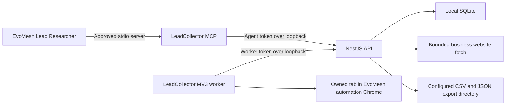

# LeadCollector architecture

EvoMesh owns Chrome and the browser-bridge grants. LeadCollector owns its
worker token, the extension's collection tabs, the storage and export
contracts, and enrichment. The same extension still supports manual
collection and CSV, JSON and XLSX export.

## Jobs and recovery

The API uses `pending → running → done | error | cancelled`. Running jobs
have an opening, scraping or enrichment phase. Times are Unix milliseconds.
The lease is renewed by the authenticated worker, keyed by worker ID and
attempt. Atomic SQLite transactions prevent concurrent claims of the same
job. By default one browser job can run, with up to 25 queued jobs and two
attempts. A job deadline includes queueing and enrichment. The automatic
collection limit is 500 and defaults to 200. The server validates result
size independently of the browser.

The MV3 worker uses a 30-second Chrome alarm, browser-session storage for
the tab assignment, and local storage for its result outbox and identity.
It stores an assignment before navigation and accepts results only from the
associated top-level document. Delivery retries reuse the same payload and
attempt. A restarted API can recognize a committed delivery and acknowledge
it again. Stale attempts receive a conflict. A browser shutdown ends session
ownership. A final payload can still be replayed from the durable outbox
while the server accepts that attempt. Otherwise, lease expiry makes the
job eligible for a bounded retry. Chrome may restore an old map tab after a
full browser restart. A restored tab without session ownership is left alone.

A cancelled job disappears from dispatch. Its browser slot stays occupied
until the worker closes its own tab and releases it, or the lease expires.
The worker checks cancellation by the next successful heartbeat. An API
outage prevents new claims. A worker closes its tab when it observes an
expired lease. It drops a delivery that the API confirms belongs to a stale
attempt. Map results already committed are available during enrichment and
remain available if enrichment is interrupted. A provider challenge ends the
current attempt with `human_required`. The operator handles access prompts
before explicitly starting a new request.

## SQLite and records

`apps/api/src/modules/jobs/migrations.ts` applies numbered `user_version`
migrations in a write transaction. Foreign keys, strict tables, explicit
status checks, indexes for dispatch, leases and retention, WAL and a busy
timeout are enabled. The database is in `LEADCOLLECTOR_STATE_DIR`, with a
git-ignored `apps/api/.leadcollector` fallback. The old API stored its jobs
in memory. There is no file to import from the old release.

| Table | Key and purpose |
| --- | --- |
| `jobs` | UUID and unique optional request key. Parameters, owner label, progress, limits, lease, timestamps, counters, errors and delivery hash |
| `workers` | Persistent worker identity, last authenticated check-in and extension version |
| `leads` | Stable UUID, latest normalized profile and searchable text |
| `provider_ids` | Unique provider and place ID aliases, indexed by lead |
| `job_leads` | Unique lead and position per job, with a stable result snapshot and case-normalized filter text |
| `lead_sources` | Append-only typed evidence, with source URL, observed time and field values |
| `lead_contacts` | Type, normalized value and source URL per lead. Last observation and optional separate verification time |
| `enrichment_runs` | One bounded attempt outcome per job and lead. Attempted URLs and error codes are retained with the lead |
| `export_artifacts` | Generated filename, original job ID, format, SHA-256, record count and creation time |

Place IDs take priority. Without a known ID, the exact normalized website
domain, business name and street-level address determine a fallback match,
with city, postal code and country included when observed. Ambiguous
matches and conflicting IDs from the same provider remain separate. Per-job
snapshots preserve observations from that collection. Search returns the
latest business profile and a bounded selection of lineage and contacts.

Job retention defaults to 30 days and can be disabled with
`LEADCOLLECTOR_JOB_RETENTION_DAYS=0`. Cleanup prunes job snapshots, retaining
canonical leads, provenance, enrichment observations, export receipts and
export files. Deleting the database manually removes the retained leads and
receipts. Outputs in a separate export directory survive a database reset.

## Enrichment and trust

The API reads static public HTML from an approved business URL and at most
one discovered same-site contact/about page. Every target checks robots
rules. DNS answers must all be public, then the request connects to a
validated address while retaining the hostname for TLS. HTML fetches use
bounded response bodies, redirects, deadlines and concurrency. They use no
browser sessions, credentials, JavaScript execution or cookies. Challenges
and access restrictions produce blocked results. Per-lead outcomes include
`found`, `not_found`, `unavailable`, `blocked`, `failed`, `skipped` and
`cancelled`. Shared mailboxes are collected where observed. Contacts have
source URLs and observation dates and are never marked independently
verified by collection alone.

Both API and MCP enforce loopback and disable credential-bearing redirects.
The API requires distinct agent and worker bearer tokens. CORS permits the
fixed unpacked Chrome extension origin and explicitly listed additional
extension IDs. The legacy root HTTP GET reveals only service liveness.
Agent and worker secrets stay in local configuration. The agent can request
an export format and job ID. File names and the output directory are set by
the backend, with no caller-supplied paths.

See [the API and MCP reference](../apps/api/MCP.md) and
[the future evidence contract](MILESTONE_4_DATA_CONTRACT.md).
